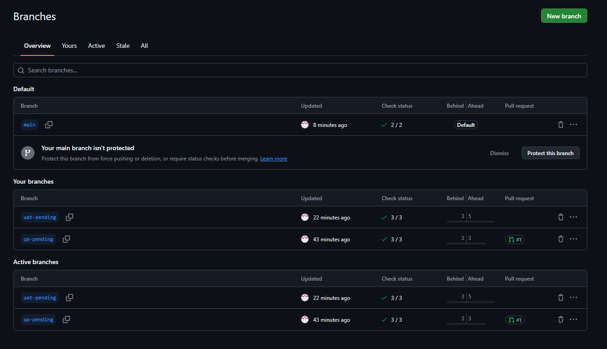
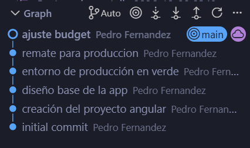
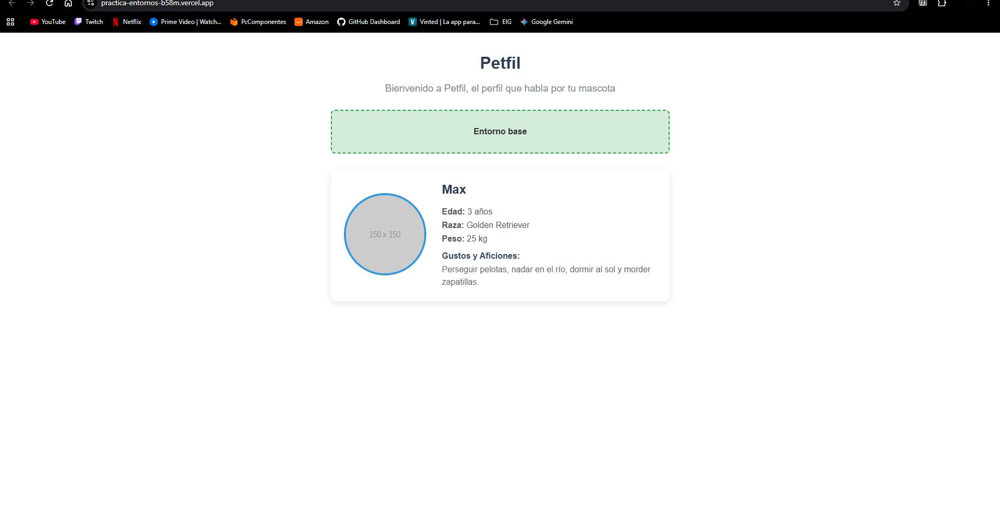
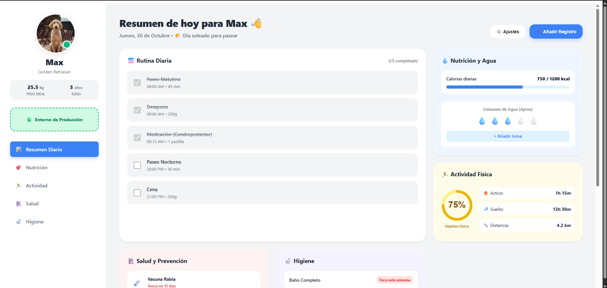
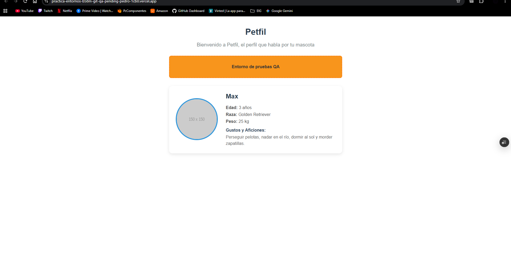
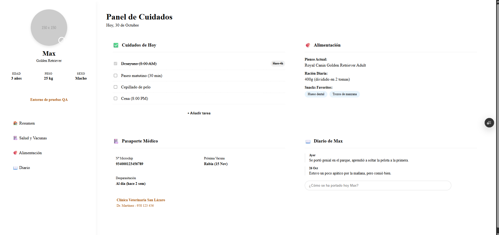
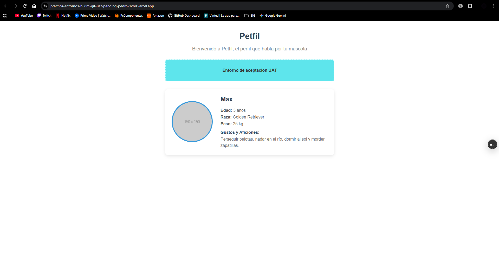
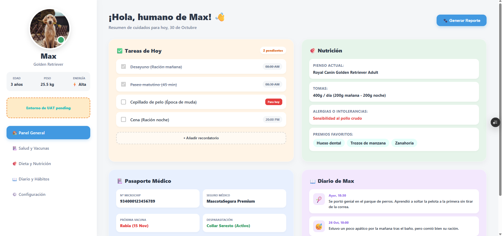
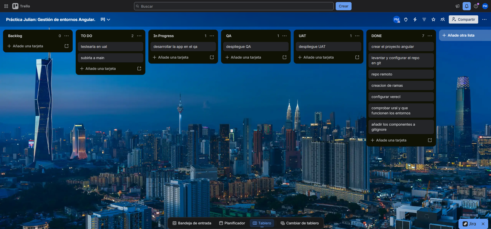

# Práctica 2: Simulación Release Manager - Gestión de Entornos Angular

**Alumno:** Pedro
**Módulo:** Desarrollo de Aplicaciones Web (DAW)

---

## 1. Enlaces del Proyecto
* **Repositorio de GitHub:** [Inserta aquí tu URL de GitHub]
* **Tablero de Trello:** [Inserta aquí la URL de tu Trello]

**URLs de los Entornos (Vercel):**
* **Producción (`main`):** [Inserta aquí la URL principal de Vercel]
* **Entorno QA (`qa-pending`):** [Inserta aquí la URL generada por Vercel para la rama qa-pending]
* **Entorno UAT (`uat-pending`):** [Inserta aquí la URL generada por Vercel para la rama uat-pending]

---

## 2. Explicación del Proceso Seguido

Para llevar a cabo la simulación de Release Manager y configurar un flujo de trabajo profesional, se han ejecutado las siguientes fases en orden cronológico:

1. **Inicialización y Control de Versiones:** Se generó un proyecto base con Angular (componentes *standalone*). Posteriormente, se inicializó un repositorio Git local y se vinculó a un repositorio remoto en GitHub.
2. **Estrategia de Ramas:** A partir de la rama principal (`main`), que representa el entorno de producción, se crearon dos ramas adicionales: `qa-pending` (para pruebas técnicas) y `uat-pending` (para validación de cliente).
3. **Despliegue Base y Automatización (Vercel):** 
   * Se importó el repositorio a Vercel vinculando la rama `main` al entorno de Producción.
   * Se desactivó la opción *Vercel Authentication* en los ajustes de *Deployment Protection* para permitir el acceso público a las URLs de previsualización (Preview) generadas automáticamente por Vercel.
4. **Configuración y Comprobación de Entornos:** Se implementó un componente visual básico para identificar cada entorno (Producción en verde, QA en naranja y UAT en azul). Se realizó el *push* a cada rama y **se comprobó de forma exhaustiva que las tres URLs funcionaban correctamente** y eran accesibles públicamente antes de avanzar con el desarrollo.
5. **Rediseño Avanzado de la Interfaz:** Una vez validada toda la infraestructura de despliegue en Vercel, se procedió a evolucionar el diseño de la aplicación. En la rama `main` (Producción), se construyó un Dashboard integral (utilizando una arquitectura visual *Bento Box*) orientado a la gestión completa de una mascota, integrando el indicador verde obligatorio en una interfaz profesional.
6. **Resolución de Incidencias de Compilación (CI/CD):** Durante el despliegue de este diseño final en Producción, Vercel reportó un error de compilación (`exceeded maximum budget`). Al integrar un CSS complejo, se superó el límite por defecto de 8kB de Angular para estilos de componentes. Se resolvió modificando el archivo `angular.json`, aumentando los umbrales de `maximumWarning` y `maximumError` en la propiedad `anyComponentStyle`.
7. **Gestión de Archivos Ignorados:** Se añadió la ruta del componente al archivo `.gitignore` para aislar los cambios y evitar que el desarrollo continuo sobrescriba la configuración visual de cada entorno.
8. **Gestión Ágil (Trello):** Todo el proceso ha sido documentado mediante un tablero Kanban en Trello, moviendo las tareas desde el *Backlog* hasta la columna *Done* conforme se superaban las fases de configuración, desarrollo y despliegue.

---

## 3. Evidencias Gráficas

### 3.1. Repositorio y Control de Versiones
**Captura de las tres ramas en GitHub (`main`, `qa-pending`, `uat-pending`):**

**Evidencias de los commits realizados (Historial de Git):**

### 3.2. Entornos de Despliegue en Vercel
**Primer entorno de Producción (Verde):**

**Entorno de Producción Funcionando (Verde - Dashboard Final):**

**Primer Entorno de Pruebas QA (Naranja):**

**Entorno de Pruebas QA Funcionando (Naranja):**

**Primer Entorno de Aceptación UAT (Azul):**

**Entorno de Aceptación UAT Funcionando (Azul):**

### 3.3. Gestión del Proyecto
**Tablero de Trello:**
